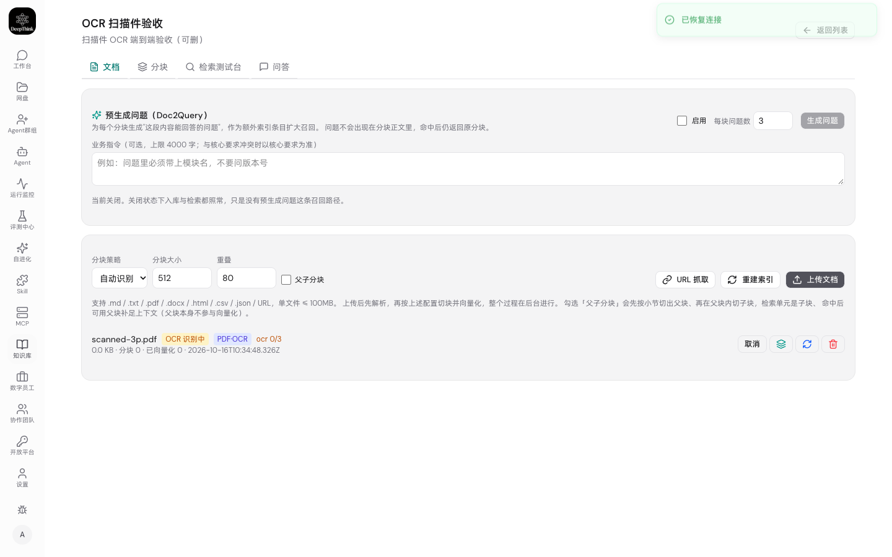
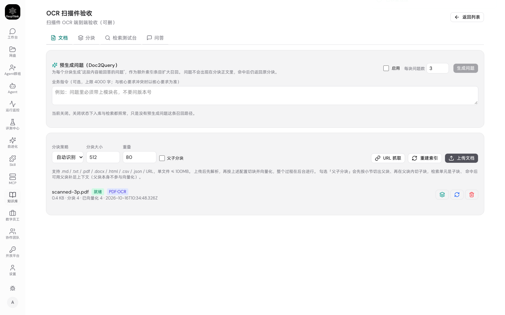

# 测试报告 · 本机内置模型服务 + 扫描件 OCR

- **日期**：2026-10-16
- **需求原文**：「扫描件要支持，9999 那个实例要配向量模型，直接系统内置部署使用开源的向量模型服务。」
- **PRD**：`docs/prd/2026-10-16-local-model-service/PRD.md`
- **方案**：`docs/tech_solution/2026-10-16-local-model-service/SOLUTION.md`
- **执行状态**：`docs/task_state/2026-10-16-local-model-service/STATE.md`
- **验收实例**：隔离实例 `:9898`（`DEEPTHINK_DATA_DIR=~/.deepthink-9898`），本机 Ollama 0.40.3
- **结论**：**端到端 21/21 通过**（§3），单元测试 2420 项全绿（§2），无回归（§4）

---

## 1. 测试环境

| 项 | 值 |
|---|---|
| 实例 | `:9898`，数据目录 `~/.deepthink-9898`（与 9999 生产实例完全隔离） |
| 模型服务 | Ollama 0.40.3 · `http://127.0.0.1:11434` |
| 向量模型 | `bge-m3`（1024 维） |
| 视觉模型 | `qwen2.5vl:7b` |
| 浏览器 | 本机 Google Chrome（`channel: 'chrome'`） |
| 夹具 | `tests/fixtures/pdf/scanned-3p.pdf`，3 页纯图片 PDF，175,013 字节 |

夹具是**可复现构建**的（`tests/fixtures/pdf/build-scanned-pdf.mjs`），页面上预置了 4 个已知关键词
（`ALPHA-7749` / `BRAVO-2251` / `CHARLIE-9930` / `Osimertinib`）。这一步是刻意的：
「返回了非空字符串」和「真的转写对了」是两件事，只有对着已知答案断言才能区分（§5 有个反例）。

---

## 2. 单元测试

```
npx vitest run
 Test Files  178 passed | 4 skipped (182)
      Tests  2420 passed | 16 skipped (2436)
```

本需求新增的三组：

| 文件 | 项数 | 覆盖 |
|---|---|---|
| `tests/units/ocr-pipeline.test.ts` | 13 | 三页对应不乱、单页失败容忍、全失败抛错、空白页不留痕、maxPages 截断、并发不串页、**截断判定**（4 项）、两套协议 |
| `tests/units/ocr-rasterize.test.ts` | 6 | PNG 魔数、dpi 尺寸关系、maxPixels 等比缩小、maxPages 截断、回调顺序、文字层 PDF 也可光栅化 |
| `tests/units/local-model.test.ts` | 11 | 模型名归一化、探测不抛异常、已启动不重复拉起、拉取进度折算、**HTTP 200 带 error 算失败**、维度探测、打不通时抛错 |

桩服务而不是真模型：真模型是 6GB 下载，不适合进 CI；而且真正会写错的是**编排与失败降级**
（并发、失败容忍、页码标记、截断判定），不是模型推理。真模型验证在 §3 的 e2e 里做。

类型检查：后端 `npx tsc --noEmit` 与 `cd web && npx tsc --noEmit` 均**无输出**（干净）。

---

## 3. 端到端验收（21/21）

脚本：`tests/e2e/kb-ocr-scan.mjs`　原始结果：`result.json`

```
DT_BASE=http://localhost:9898 DT_USER=admin DT_PASS='***' node tests/e2e/kb-ocr-scan.mjs
```

```
✅ 登录成功
✅ 完成初始化引导
✅ 本机模型服务可用 — 0.40.3
✅ 扫描件 OCR 已启用 — qwen2.5vl:7b
✅ 视觉模型已安装 — qwen2.5vl:7b, ...
✅ 点「上传文档」能唤起文件选择框（真实用户路径）
✅ 上传被接受（201）
✅ 响应带 ocr 标志，走的是扫描件通道
✅ 文档进入「OCR 识别中」状态
✅ 文档最终变为「就绪」
✅ 文档记录存在 — scanned-3p.pdf
✅ parser_type = pdf_ocr
✅ 分块数 > 0 — chunk_count=4
✅ 正文含扫描页里的真实词 ALPHA-7749
✅ 正文含扫描页里的真实词 BRAVO-2251
✅ 正文含扫描页里的真实词 CHARLIE-9930
✅ 正文含扫描页里的真实词 Osimertinib
✅ 正文不是页码噪声（不含伪造的页码标记）
✅ 用扫描页里的词检索能命中该文档
✅ 关闭 OCR 时上传扫描件返回 400
✅ 错误信息指向设置页（可执行，不是"上传失败"四个字）
✅ 被拒绝的上传没有留下文档行

扫描件 OCR 端到端验收：21/21 通过
```

### 3.1 AC-1 上传走真实入口

必须点按钮 → 等 `filechooser` 事件 → 再 `setFiles`。**不能**直接 `setInputFiles()` 给 input 赋值 ——
那条路绕过了「点击 → 转发 → 弹框」这一跳，而这一跳在本项目历史上真的坏过（`48ef60a`，
`label` 吞掉了对 `button` 的点击）。

响应体（硬证据）：

```json
HTTP 201
{"document":{"id":"ab54f037-...","filename":"scanned-3p.pdf",
             "content_hash":"pending:ab54...","parser_type":"pdf_ocr",
             "parse_status":"ocr", ...},
 "ocr":{"model":"qwen2.5vl:7b","baseUrl":"http://127.0.0.1:11434"}}
```

### 3.2 AC-1 实时进度（截图）



列表里是黄色 `OCR 识别中` 徽标 + `PDF·OCR` 解析器标签 + `ocr 0/3` 实时进度。
上传接口当场返回，进度靠列表轮询 —— 这正是「287 页不能同步做」要求的形态。

### 3.3 AC-2 终态（截图）



`就绪` · `PDF·OCR` · `0.4 KB · 分块 4 · 已向量化 4`。

接口侧的完整阶段记录：

```json
{"parser_type":"pdf_ocr","parse_status":"ready","chunk_count":4,
 "embedded_chunk_count":4,"embedding_dim":1024,
 "stages":[{"stage":"parse","status":"ok","ms":0},
           {"stage":"chunk","status":"ok","ms":4,"detail":"4 chunks via heading"},
           {"stage":"embed","status":"ok","ms":19062,"detail":"4/4 embedded"}]}
```

从上传（10:34:48）到就绪（10:35:55）**共 67 秒**，含模型首次载入显存与 4 个分块的向量化。

### 3.4 AC-3 分块正文（全文）

```markdown
【第 1 页】

| Page One |
| --- |
| Keyword: ALPHA-7749 |
| This page has no text layer at all. |

【第 2 页】

Page Two

| Drug | Dosage |
| --- | --- |
| Osimertinib 80 mg once daily | |
| Code: BRAVO-2251 | |

【第 3 页】

| Page Three |
| --- |
| Review every 6 weeks |
| Keyword: CHARLIE-9930 |
```

四个预置关键词**全部命中**，表格是**带 `| --- |` 分隔行的合法 Markdown 表格** ——
行列结构保住了，这正是弃用 tesseract / PaddleOCR 的理由：传统 OCR 的输出是按行拼接的散字，
「Osimertinib 80 mg once daily」和「Code: BRAVO-2251」会被拼成一句话，检索语义就乱了。

另外断言了正文里**不含** `-- n of N --` 形式的伪造页码 —— 那是 D8 缺陷的形态，
扫描件本该抽出空串，被伪造标记一填就成了非空文本，空值守卫失效、噪声静默入库。

### 3.5 AC-4 检索命中

```json
POST /api/paas/knowledge-bases/<id>/search
{"query":"Osimertinib 的用法用量是多少？","top_k":5,"mode":"hybrid"}

→ 4 条命中，top1 content: "\nPage Two\n\n| Drug | Dosage |\n| --- | --- |\n| Osime..."
```

用**扫描页里的词**发问，命中的正是 OCR 出来的那一页。关键词臂（trigram 子串）对中文整句
本来就不命中，这条能过说明**向量臂真的在工作** —— 也解释了为什么「扫描件支持」和
「配向量模型」必须一起做：只做前者，OCR 出来的正文照样检索不到。

### 3.6 AC-5 前置条件不满足时当场拒绝

临时关闭 OCR 再传一次同一份扫描件：

```
界面提示：该 PDF 没有文字层（扫描件），需要 OCR，但 OCR 当前未启用。
         请在「设置 → 本机模型服务」中启用扫描件 OCR 后重新上传。
HTTP 400 {"error":"该 PDF 没有文字层（扫描件）…","code":"ocr_disabled"}
✅ 被拒绝的上传没有留下文档行 — 1 → 1
```

三个要点都验到了：**当场**返回（不是等半小时才失败）、错误信息**可执行**（指了具体去哪一页做什么）、
被拒的上传**不留文档行**（1 → 1，没多出东西）。

---

## 4. 回归

- 全量单元测试 2420 项通过，无既有用例被破坏。
- 既有 e2e `tests/e2e/kb-pdf-upload.mjs` 的断言前提仍然成立（扫描件报错信息与本次改动一致）。
- 前端 `KnowledgeBaseDetailPage` 的改动是**增量**的（新增 `ocr` 状态与标签），
  `PENDING_STATUSES` 加入 `'ocr'` 后轮询不会提前停。

---

## 5. 本轮真正值钱的发现：一个静默丢页的缺陷

**这不是"测试跑挂了"，是一个跑绿了但结果是错的缺陷。**

第一版实现跑 3 页夹具时，返回 `ocrPages: 3`，正文里却**只有【第 3 页】**，
第 1、2 页凭空消失，**没有任何报错**。

根因：`qwen3-vl:8b` 是思维链模型。Ollama 默认 `num_ctx=4096`，一页 150dpi 扫描图
光图片就占约 2200 token，模型把剩余额度全烧在 reasoning 上，然后：

```
finish_reason: "length"   total_tokens: 4096   contentLen: 0   reasonLen: 4196
```

`content` 为空。旧代码把这个空当成「空白页」跳过。

**为什么它比崩溃更危险**：287 页的扫描件会静默丢掉大半，用户看到的是「上传成功、状态就绪」，
检索不到内容却无从追查 —— 没有任何一条日志、任何一个红色状态能让他想到是丢了页。

修法两条，缺一不可：

1. **走 Ollama 原生 `/api/chat`**。实测在 `/v1/chat/completions` 里传 `options.num_ctx=16384`，
   调用后 `GET /api/ps` 仍显示 `ctx=4096` —— **OpenAI 兼容端点静默忽略 `num_ctx`**。
   换原生协议后 `ctx=16384`、`done_reason=stop`、正文正确。
2. **截断与空白分开判定**。`done_reason`/`finish_reason === 'length'`，或「有思维链但正文为空」，
   都记为该页**失败**并在正文末尾留痕，**绝不**计入 `emptyPages`。

修复后的真模型实测（同一份夹具）：

```
【第 1 页】# DeepThink OCR Fixture ...
【注意：第 2 页 OCR 失败，正文缺失。】     ← 失败写进正文了
空页 0                                      ← 旧代码在同样情况下会报「空页 1」并静默丢掉
```

回归用例锁在 `tests/units/ocr-pipeline.test.ts` 的「截断必须被当成失败，而不是空白页」4 项。

### 5.1 另一个反例：`moondream` —— 指标全绿，结果是错的

| 模型 | 3 页 API 调用 | 耗时 | 关键词命中 | 实际输出 |
|---|---|---|---|---|
| `moondream` | 3/3 成功 | 7.5s | 0/4 | "The image shows a white piece of paper with black text on it…"，并把 `CHARLIE-9930` **幻觉**成 `charlee-9000` |

只看接口指标（成功率、耗时、返回非空）它是三个模型里**最好**的。它失败在
**忽略了"逐字转写"的指令去"描述图片"** —— 这是视觉模型的默认行为，也是 OCR 提示词里
第 1 条和第 5 条必须存在的原因。这类失败只能靠**对着已知答案断言关键词**才能发现，
所以夹具里预置了 4 个关键词。

---

## 6. 默认视觉模型选型（拿数据定）

同夹具、同产品代码 `ocrPdf()`、原生 `/api/chat`、`num_ctx=16384`、串行：

| 模型 | 单页耗时 | 3 页结果 | 关键词 | 287 页（并发 2）估算 |
|---|---|---|---|---|
| `qwen3-vl:8b` | 51s / **>300s 超时** / 52s | 丢 1 页 | 2/4 | **6–12 小时** ❌ |
| **`qwen2.5vl:7b`** | **20s / 15s / 14s** | **全中，0 失败** | **4/4** | **约 38 分钟** ✅ |
| `moondream` | 7.5s | 3 页都"成功" | 0/4（幻觉） | ❌ 质量不合格 |

选中 `qwen2.5vl:7b`。它是非思维链模型，**质量也不比 qwen3-vl 差**：
夹具第 2 页的关键词（`Osimertinib` / `BRAVO-2251`）qwen3-vl 因该页超时而漏掉，qwen2.5vl 全部认出；
输出还是带 `| --- |` 分隔行的合法 Markdown 表格（qwen3-vl 的输出缺这一行）。

已改 `RECOMMENDED_VISION_MODEL = 'qwen2.5vl:7b'`。链路对两种模型都支持，
想换回思维链模型只需改 `data/config/ocr.json` 的 `model`，代码不用动。

---

## 7. 遗留与未验

| 项 | 说明 |
|---|---|
| 287 页真实扫描件未跑完整轮 | 按 16s/页、并发 2 估算约 38 分钟；夹具 3 页已验通链路，**未验长时间稳定性** |
| 页眉页脚重复 | 287 页的页眉会在每页重复出现，进入索引形成噪声。**本次不处理**，规则容易误删正文 |
| 跨页表格 | 跨页拆开的表格被当成两张表 |
| 手写体 / 低质量扫描 | 质量不保证，取决于模型 |
| AC-6（单页失败留痕） | 夹具构造不出稳定的单页失败，改由单测锁定（桩服务精确复现） |

---

## 8. 复现方式

```bash
# 1) 起隔离实例（不要用 9999 生产实例做验收）
make start-prod PORT=9898
DEEPTHINK_DATA_DIR=~/.deepthink-9898 npx tsx src/admin-account-cli.js create admin '<pass>'

# 2) 向量模型配置（隔离实例需自带，否则向量臂整体跳过）
mkdir -p ~/.deepthink-9898/config
cat > ~/.deepthink-9898/config/embedding.json <<'JSON'
{"baseUrl":"http://127.0.0.1:11434/v1","apiKey":"ollama","model":"bge-m3","dimensions":1024}
JSON

# 3) 端到端验收（真实 UI、真实按钮、真实检索）
DT_BASE=http://localhost:9898 DT_USER=admin DT_PASS='<pass>' \
  node tests/e2e/kb-ocr-scan.mjs
# 截图与分块正文落到 logs/kb-ocr-scan/
```
