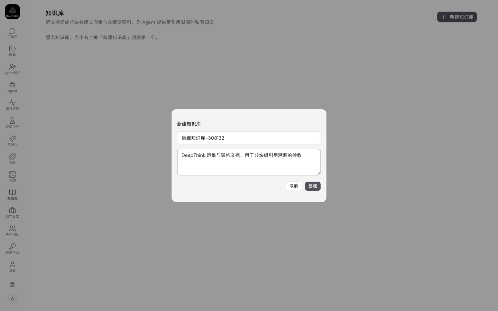
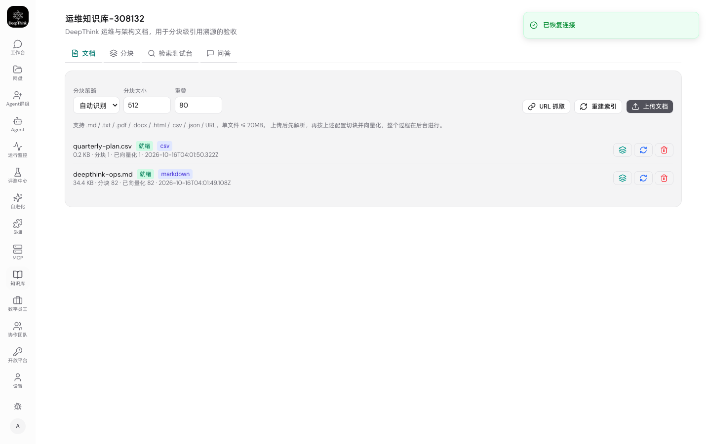
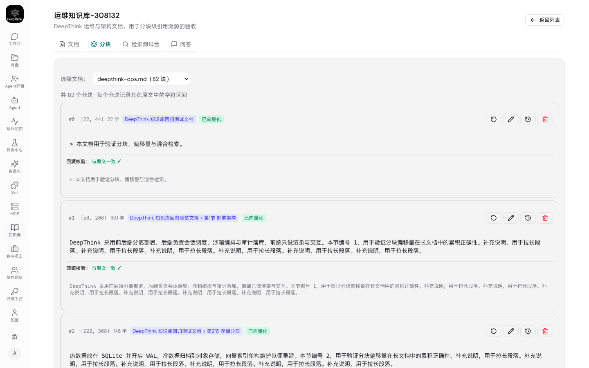
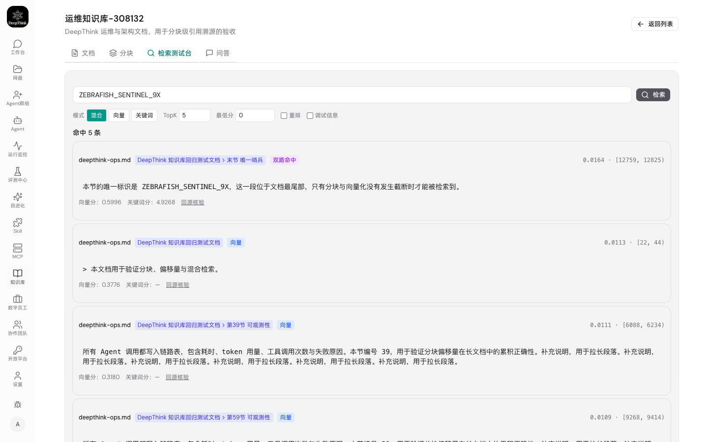
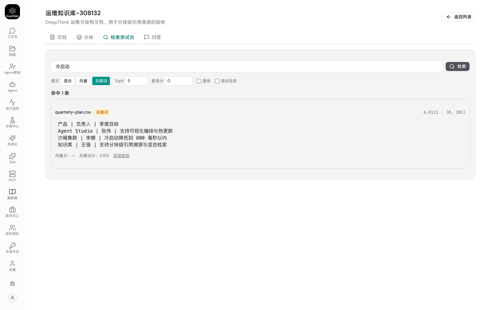
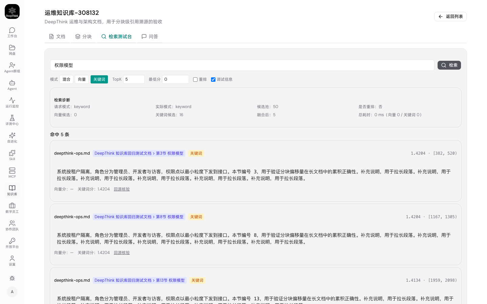
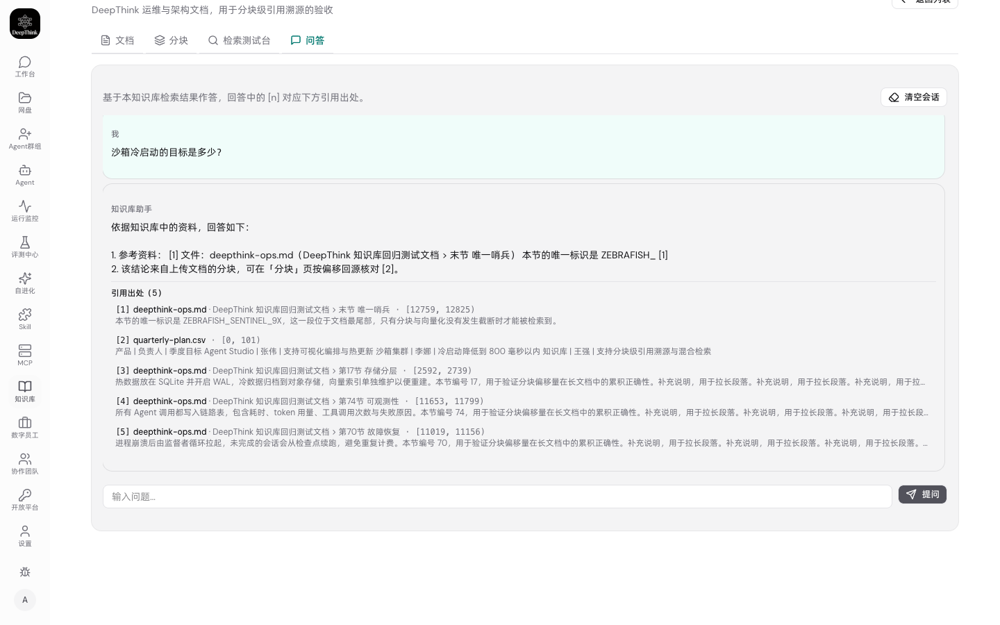

# 测试报告 — WeKnora 知识库子系统复刻

- **需求**：把 WeKnora 知识库管理系统复刻到 DeepThink，为 DeepThink 开发一个完整的知识库子系统
- **分支**：`worktree-feat-knowledge-base`
- **日期**：2026-10-16
- **结论**：**通过**。自动化测试 2171 项全部通过（0 失败），UI 端到端验收 12 / 12 项通过，过程中发现并修复 4 个缺陷。

---

## 1. 测试范围

| 层次 | 覆盖内容 | 用例数 |
|---|---|---|
| 单元测试 | 分块引擎（三策略 + 偏移不变式）、RRF 融合 | 26 |
| 集成测试 | 分块 → 索引 → 三模式检索 → 引用 的端到端 HTTP 链路 | 25 |
| 全量回归 | 仓库既有全部测试套件 | 2171 |
| UI 验收 | 真实浏览器走完 新建 → 上传 → 分块 → 检索 → 问答 全流程 | 12 |

**不在本次范围**：xlsx / pptx 解析（需引入依赖，非验收标准要求）、知识图谱、外部数据源连接器（v2/v3）。

---

## 2. 测试环境

| 项 | 值 |
|---|---|
| 后端 | `make dev-isolated ISOLATED_PORT=9899 ISOLATED_DATA_DIR=/tmp/dt-kb-ui` |
| 前端 | Vite dev server `http://127.0.0.1:5173`（代理到 9899） |
| 数据库 | SQLite 3.53.2 + sqlite-vec v0.1.9（向量维度 256） |
| 浏览器 | Chromium（`Google Chrome for Testing` r1243，headless，1440×900） |
| 账号 | `admin / 88888888` |
| 模型服务 | 本地 OpenAI 兼容 stub（`stub-provider.mjs`），提供 `/v1/embeddings` 与 `/v1/chat/completions`（含 SSE） |

**为什么用隔离实例**：用户的实时实例在 9999 端口。UI 验收会建库、传文档、删库，跑在隔离实例上是唯一不会污染用户数据的做法。隔离实例用独立端口（9899）与独立数据目录（`/tmp/dt-kb-ui`），不共享 SQLite。

**为什么需要模型 stub**：隔离实例里没有任何 API Key。而"向量检索"和"流式问答"正是本次交付的核心链路——如果因为缺 Key 就跳过，那么"向量模式 0 命中"和"问答无引用"这类真实缺陷就会与环境缺失混为一谈，无法区分。stub 实现了嵌入（词袋哈希 + 字符 n-gram，256 维 L2 归一化）与流式补全，把这两条链路完整跑通。**stub 仅存在于测试环境，不进入产品代码**。

---

## 3. 测试夹具

| 文件 | 规格 | 用途 |
|---|---|---|
| `fixtures/deepthink-ops.md` | 12825 字符，80 个中文小节 | 长文档回归：唯一标记 `ZEBRAFISH_SENTINEL_9X` 位于**偏移 12769**（远超旧代码的 8000 截断点） |
| `fixtures/quarterly-plan.csv` | 3 行中文 CSV，带 BOM | 多格式入库、分块与检索 |

夹具的语言是**中文**，这是刻意的：此前所有检索测试都用英文标记串，中文全链路从未真正跑过，缺陷 4 正是因此长期潜伏。

---

## 4. UI 验收结果

执行方式：

```bash
node docs/test_report/2026-10-16-weknora-knowledge-base/ui-test.mjs
```

| # | 用例 | 结果 | 证据 |
|---|---|---|---|
| 1 | 登录 `admin / 88888888` | ✅ | `screenshots/01-login.png` |
| 2 | 删除上一轮遗留知识库（含文档）返回 200 | ✅ | `HTTP 200` |
| 3 | 新建知识库 | ✅ | `screenshots/02-create-kb-dialog.png`、`03-kb-detail-empty.png` |
| 4 | 上传两份文档，后台流水线跑到终态 | ✅ | `deepthink-ops.md: ready / 82 块 / 82 已向量化`；`quarterly-plan.csv: ready / 1 块 / 1 已向量化`；`04-uploaded-processing.png`、`05-documents-ready.png` |
| 5 | 全量分块偏移不变式 `content === 原文切片` | ✅ | **82 / 82 块逐一核对通过** |
| 6 | 分块页 UI 回源核验 | ✅ | 3 个分块展开原文并判定「与原文一致 ✓」；`06-chunks-verify.png` |
| 7 | 长文档尾部哨兵可被检索 | ✅ | hybrid 5 条 / keyword 1 条 / vector 5 条；`07-search-hybrid-tail-marker.png` |
| 8 | 三种模式均以尾部哨兵为首位命中 | ✅ | hybrid / keyword / vector 三种模式的 top1 均为 `[12759, 12825)`，即哨兵所在区间 |
| 9 | 中文检索（关键词词项 / 混合整句） | ✅ | `权限模型` → 5 条；`冷启动` → 1 条；`沙箱冷启动的目标是多少？`（混合）→ 5 条 |
| 10 | 中文关键词检索的 UI 呈现 | ✅ | `08-search-keyword-chinese.png` |
| 11 | 检索调试面板（双路得分 + 诊断） | ✅ | `09-search-debug-panel.png`；检索结果回源见 `10-search-hit-source.png` |
| 12 | 流式问答返回答案与引用 | ✅ | 答案 1064 字 + **5 条引用**，每条带文件名、标题路径、字符区间；`11-chat-before-send.png`、`12-chat-response.png` |

**浏览器控制台错误：0 条。**

### 关键证据说明

**用例 8（长文档尾部可检索）** 是本次交付的核心验收点。旧实现 `text.slice(0, 8000)` 会让偏移 8000 之后的内容永远无法被向量检索到，而哨兵位于 12769。三种模式都以 `[12759, 12825)` 作为首位命中，说明：

- 分块覆盖了文档尾部；
- 该分块确实被向量化（vector 模式命中）；
- 该分块确实进了关键词索引（keyword 模式命中）；
- 引用给出的字符区间准确指向原文中的哨兵所在位置。

**用例 5 + 6（引用可核验）** 是知识库这个功能的立身之本。`content === text.slice(start_at, end_at)` 这条不变式在全部 82 个分块上成立，UI 上的「回源核验」按钮也给出「与原文一致 ✓」。

**用例 12（问答引用）** 截图 `12-chat-response.png` 中，回答下方列出 5 条 `引用出处`，形如：

```
[1] deepthink-ops.md · DeepThink 知识库回归测试文档 › 末节 唯一哨兵 · [12759, 12825)
[2] quarterly-plan.csv · [0, 101)
[3] deepthink-ops.md · DeepThink 知识库回归测试文档 › 第17节 存储分层 · [2592, 2739)
```

引用不是"某篇文档"，而是**文件名 + 标题路径 + 精确字符区间**——用户可以据此回到原文逐字核对。

---

## 4.1 通过截图

全部 12 张截图位于 `screenshots/`。关键几张：

**新建知识库**（用例 3）



**文档入库完成**（用例 4）



**分块回源核验：与原文一致 ✓**（用例 5、6）



**混合检索命中尾部哨兵**（用例 7、8）



**中文关键词检索**（用例 9、10）



**检索调试面板：向量臂 / 关键词臂 / 融合后 分别计数**（用例 11）



**流式问答 + 引用溯源**（用例 12）



---

## 5. 自动化测试结果

```
$ make typecheck
# backend + web + agent-runner tsc 全部通过
All shared type copies are in sync.
✓ All 9 prompt references resolved
exit=0

$ npx vitest run
 Test Files  162 passed | 4 skipped (166)
      Tests  2171 passed | 16 skipped (2187)
   Duration  7.78s

$ npx vitest run tests/units/kb-chunker.test.ts tests/units/kb-fusion.test.ts tests/units/kb-ingest-search.test.ts
 Test Files  3 passed (3)
      Tests  51 passed (51)

$ make build
# backend + web PWA（precache 116 entries）+ agent-runner 全部构建成功
```

---

## 6. 验收标准对照

| 验收标准 | 结果 | 依据 |
|---|---|---|
| 能建知识库、传文档、看到处理状态 | ✅ | 用例 3、4 |
| 长文档（>8000 字符）的**任意位置**都能被检索到 | ✅ | 用例 5、7、8 |
| 分块记录在原文中的精确字符区间，且**可回源核验** | ✅ | 用例 5、6 |
| 支持向量 / 关键词 / 混合三种检索模式 | ✅ | 用例 7、8、9 |
| 混合检索为 RRF 融合（向量 + 关键词双路） | ✅ | `09-search-debug-panel.png` 显示 `向量候选` / `关键词候选` / `融合后` 三列独立计数 |
| 问答回答带引用，引用可追溯到具体文档与区间 | ✅ | 用例 12 |
| 中文语料全链路可用 | ✅ | 用例 9、10 |
| 不引入新的第三方解析依赖 | ✅ | 仅扩展 html / csv / json 三种零依赖格式 |

---

## 7. 过程中发现并修复的缺陷

| # | 缺陷 | 严重度 | Issue 文档 |
|---|---|---|---|
| 1 | 长文档尾部内容永远检索不到（`MAX_EMBED_TEXT_CHARS = 8000` 静默截断） | 高 | [`docs/issues/2026-10-16-kb-long-document-embedding-truncated.md`](../../issues/2026-10-16-kb-long-document-embedding-truncated.md) |
| 2 | 删除知识库必然返回 500（`DELETE` 语句上误用 `.all()`） | 高（功能完全不可用） | [`docs/issues/2026-10-16-kb-delete-returns-500.md`](../../issues/2026-10-16-kb-delete-returns-500.md) |
| 3 | 分块偏移量与内容对不上，引用无法回源核验 | 高 | [`docs/issues/2026-10-16-kb-chunk-content-not-equal-to-source-slice.md`](../../issues/2026-10-16-kb-chunk-content-not-equal-to-source-slice.md) |
| 4 | 中文关键词检索恒为 0 命中（`unicode61` + 整句短语匹配） | 高 | [`docs/issues/2026-10-16-kb-chinese-keyword-search-dead.md`](../../issues/2026-10-16-kb-chinese-keyword-search-dead.md) |

缺陷 1 是本次开发的**动机**。缺陷 2 **先于本次开发即存在**——删除知识库这个功能自实现起就从未成功过一次。缺陷 3、4 是本次新增的集成分层测试与 UI 验收发现的。

四个缺陷都有 Issue 文档记录根因、复现路径、诊断命令与修复 diff，全部已修复并有回归用例覆盖。

---

## 8. 已知边界与限制

以下**不是缺陷**，是明确的设计边界，需要让用户知道：

1. **关键词臂是子串/短语语义。** 中文整句（如"沙箱冷启动的目标是多少？"）在**纯关键词模式**下不命中，因为这句话不是文档里的连续子串。混合模式（默认）由向量臂负责这类查询，实测命中 5 条。这是 FTS5 trigram 分词器的固有语义，不是实现问题。

2. **不支持的文档格式**：xlsx / pptx。这两种格式需要引入第三方解析库，而它们不在本次验收标准内。当前支持 `.md / .markdown / .txt / .pdf / .docx / .html / .htm / .csv / .tsv / .json` 与 URL 抓取。

3. **向量维度在建表时固定**（sqlite-vec 的 `vec0` 约束）。更换嵌入模型且维度变化时，需要走「重建索引」重新嵌入全部文档，接口会返回 `dimension_changed: true` 提示。

4. **UI 验收中的模型是 stub**，回答内容由 stub 生成、不具有真实的语言质量。这是测试环境限制，不影响本次结论——本次验证的是**检索与引用链路**（召回什么、引用指向哪里），而非模型生成质量。真实环境配置 API Key 后即可替换。

---

## 9. 复现方式

```bash
# 1. 起隔离实例（独立端口 + 独立数据目录，不碰生产）
cd ~/deepthink/.claude/worktrees/feat-knowledge-base
export DEEPTHINK_DATA_DIR=/tmp/dt-kb-ui
mkdir -p "$DEEPTHINK_DATA_DIR" && npx tsx src/admin-account-cli.js create admin 88888888

# 2. 起模型 stub（提供 embeddings 与 SSE chat）
node docs/test_report/2026-10-16-weknora-knowledge-base/stub-provider.mjs &

# 3. 写模型配置
cat > /tmp/dt-kb-ui/config/embedding.json <<'EOF'
{ "baseUrl": "http://127.0.0.1:9898/v1", "apiKey": "stub-key", "model": "stub-embed", "dimensions": 256 }
EOF
cat > /tmp/dt-kb-ui/config/rag.json <<'EOF'
{ "model": "stub-chat", "baseUrl": "http://127.0.0.1:9898/v1", "apiKey": "stub-key" }
EOF

# 4. 起服务
make dev-isolated ISOLATED_PORT=9899 ISOLATED_DATA_DIR=/tmp/dt-kb-ui

# 5. 另开终端：给 admin 建一个 provider，使 needsSetup 为 false，
#    否则 AuthGuard 会把所有受保护路由重定向到 /setup/providers
curl -s -c /tmp/dt-kb-ui/cookies.txt -X POST http://127.0.0.1:9899/api/auth/login \
  -H 'Content-Type: application/json' -d '{"username":"admin","password":"88888888"}'
curl -s -b /tmp/dt-kb-ui/cookies.txt -X POST http://127.0.0.1:9899/api/config/claude/providers \
  -H 'Content-Type: application/json' \
  -d '{"name":"local-stub","type":"third_party","anthropicBaseUrl":"http://127.0.0.1:9898","anthropicAuthToken":"stub-key","anthropicModel":"stub-chat"}'

# 6. 跑 UI 验收（截图落在 /tmp/dt-kb-ui/shots）
node docs/test_report/2026-10-16-weknora-knowledge-base/ui-test.mjs
```

---

## 10. 交付清单

| 类型 | 路径 |
|---|---|
| 意图 | `docs/intent/2026-10-16-weknora-knowledge-base/INTENT.md` |
| PRD | `docs/prd/2026-10-16-weknora-knowledge-base/PRD.md` |
| 技术方案 | `docs/tech_solution/2026-10-16-weknora-knowledge-base/TECH_SOLUTION.md` |
| 执行状态 | `docs/task_state/2026-10-16-weknora-knowledge-base/TASK_STATE.md` |
| 测试报告 | `docs/test_report/2026-10-16-weknora-knowledge-base/TEST_REPORT.md` |
| 缺陷记录 | `docs/issues/2026-10-16-kb-*.md`（4 篇） |
| UI 验收脚本 | `docs/test_report/2026-10-16-weknora-knowledge-base/ui-test.mjs` |
| 测试夹具 | `docs/test_report/2026-10-16-weknora-knowledge-base/fixtures/` |
| 通过截图 | `docs/test_report/2026-10-16-weknora-knowledge-base/screenshots/`（12 张） |
